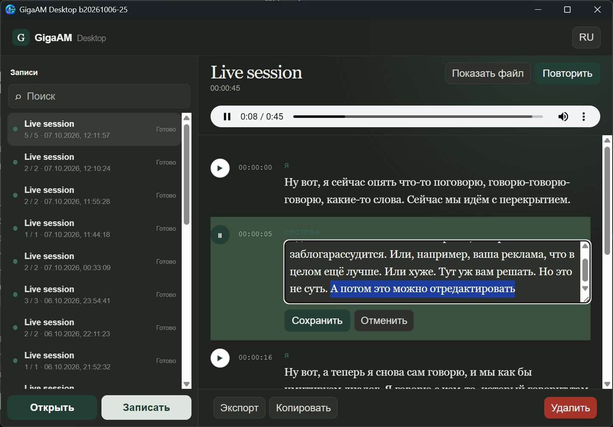

# GigaAM Desktop

> 🇬🇧 [English documentation](README.md)

Десктопное приложение для **локального распознавания русской речи**: импорт аудио/видео и живая запись микрофона и системного звука. Распознавание выполняется на устройстве с GigaAM v3, Silero VAD и ONNX Runtime; после однократной загрузки моделей транскрибация работает без интернета.

**Статус:** активная разработка, версия до 1.0 · **Платформы:** Windows x64; macOS 15+ на Apple Silicon, если macOS-файл присутствует в релизе · **[Скачать последний релиз](https://github.com/kwexz/GigaAM-Desktop/releases/latest)**

В релизе публикуются установщик и portable-файл для Windows x64. Подписанный и нотаризованный пакет macOS arm64 доступен только тогда, когда он перечислен в конкретном релизе: задачи двух платформ завершаются независимо. Windows-сборки намеренно не подписаны и могут вызвать SmartScreen. Linux не поддерживается.



## Что реализовано

- Импорт WAV, MP3, FLAC, OGG, M4A, MP4, MKV, AVI и MOV через диалог или drag-and-drop.
- Запись микрофона, системного звука или обоих источников отдельными треками; пауза/продолжение, настройка усиления микрофона и архив FLAC, WAV или MP3.
- Локальный пайплайн Silero VAD, чанкинга и int8 GigaAM v3 E2E CTC через ONNX Runtime — с пунктуацией и нормализацией текста.
- Очередь и поиск по истории в SQLite; прерванные задания помечаются и перезапускаются.
- Воспроизведение с таймкода реплики, инлайн-правка, копирование полного текста и повторное распознавание.
- Экспорт TXT, SRT, WebVTT и JSON с сохранением меток микрофона/системы.
- Переключение интерфейса между русским и английским.

## Демонстрация за 60 секунд

1. Запустите приложение и один раз нажмите **Загрузить**, чтобы установить зафиксированные модели (~227 МБ).
2. Нажмите **Открыть** или перетащите медиафайл. Он пройдёт очередь и появится в истории с репликами и таймкодами.
3. Нажмите таймкод для воспроизведения, исправьте реплику прямо в списке и найдите запись по имени или тексту.
4. Нажмите **Записать**, выберите микрофон, системный звук или оба источника и остановите запись. В dual-сессии треки сохраняются отдельно с метками **Я** и **Система**.
5. Выберите TXT, SRT, WebVTT или JSON и нажмите **Экспорт**.

Скриншот выше показывает реальное приложение, а шаги раздела дают воспроизводимый сценарий самостоятельной проверки. Макеты и неподтверждённые показатели не используются.

## Как попробовать релиз

1. Скачайте файл для своей ОС в [GitHub Releases](https://github.com/kwexz/GigaAM-Desktop/releases/latest).
2. Запустите приложение. Windows SmartScreen может показать предупреждение, потому что текущий исполняемый файл не подписан.
3. Нажмите **Загрузить** в баннере модели. Приложение скачает зафиксированные артефакты, проверит размер и SHA-256 и атомарно установит их.
4. После исчезновения баннера сеть не нужна ни для файловой, ни для live-транскрибации.

Пути к моделям:

- Windows: `%APPDATA%\ru.gigaam.desktop\models`
- macOS: `~/Library/Application Support/ru.gigaam.desktop/models`

Источники, хэши, поведение при повторной загрузке и ручная проверка описаны в [документе о моделях](docs/MODEL.md).

## Сборка из исходников

Требования:

- Node.js **24.11.1** и npm 11 — версии из CI
- Rust **1.99.0**, зафиксированный в `rust-toolchain.toml`
- [системные зависимости Tauri 2](https://v2.tauri.app/start/prerequisites/)
- Windows: Visual Studio Build Tools с C++ workload и WebView2
- macOS: macOS 15+, Apple Silicon и Xcode 26+ для текущей зависимости ScreenCaptureKit

```powershell
npm ci
npm run tauri dev
```

Для первого распознавания или записи всё равно потребуется загрузить модели, как описано выше. Релизные пакеты собираются командами:

```powershell
npm run tauri build -- --bundles nsis -- --locked   # Windows: NSIS + release exe
```

```bash
npm run tauri build -- --bundles dmg,app -- --locked # macOS: DMG + app
```

Локальный macOS-пакет не равнозначен подписанному и нотаризованному артефакту release workflow. Расширенные инструкции и диагностика — в [руководстве разработчика](docs/DEVELOPMENT.ru.md).

`npm test` запускает сфокусированные UI interaction tests; Rust-тесты покрывают очередь, SQLite recovery, экспорт, обработку аудио, проверку моделей и streaming pipeline.

## Проверка проекта

Это те же основные проверки, которые выполняет `.github/workflows/build.yml`:

```powershell
npm ci
npm run check
npm test
npm run build
cargo test --locked --manifest-path src-tauri/Cargo.toml --lib
cargo test --locked --manifest-path src-tauri/Cargo.toml --features inference-spike --bin inference-spike
cargo check --locked --manifest-path src-tauri/Cargo.toml --bin gigaam-desktop
```

GitHub Actions для каждого push и pull request собирает Windows NSIS и неподписанный macOS app на GitHub-hosted runners. Теги `v*` публикуют Windows-пакеты и запускают подписанную/нотаризованную macOS-сборку на GitHub-hosted Apple Silicon runner с Apple credentials из secrets репозитория.

## Инженерные материалы

В проекте реализованы персистентная однопоточная очередь, инкрементальная запись сегментов, streaming VAD с ограниченным окном, синхронизированный захват двух треков, микширование по запросу, проверка моделей и восстановление прерванных заданий.

- [Архитектура и потоки данных](docs/ARCHITECTURE.ru.md) — сохранённые схемы, live-пайплайн, хранилище, команды и структура кода
- [Разработка и проверки](docs/DEVELOPMENT.ru.md) — зависимости, сборки, тесты, CI/release и диагностика
- [Модели и офлайн-режим](docs/MODEL.md) — зафиксированные артефакты и цикл установки
- [Сторонние компоненты и лицензии](docs/THIRD_PARTY_NOTICES.md) — атрибуция моделей и runtime-зависимостей

## Лицензия и атрибуция

Оригинальный исходный код репозитория доступен по [лицензии MIT](LICENSE). Эта лицензия **не перелицензирует** сторонние модели, библиотеки и SDK платформ. GigaAM, ONNX-конверсия, Silero VAD, ONNX Runtime, Symphonia, `shine-rs`, Tauri и остальные зависимости сохраняют собственные лицензии — см. [сторонние компоненты и лицензии](docs/THIRD_PARTY_NOTICES.md). В частности, используемый для MP3-архива `shine-rs` заявляет LGPL-2.0.

GigaAM Desktop — независимый клиент и не позиционируется как официальное приложение GigaAM.
