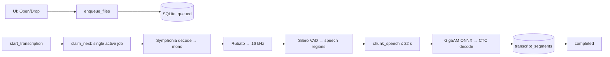
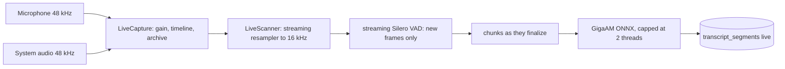
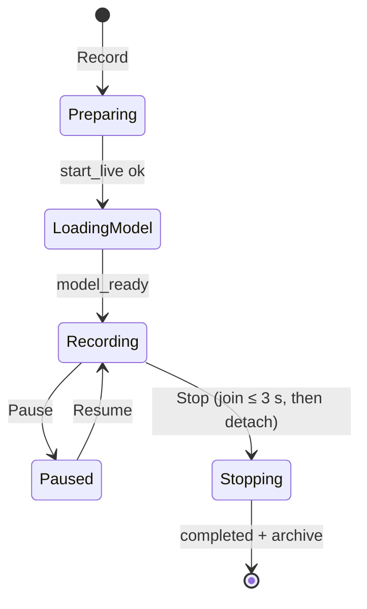

# Architecture

This document preserves the detailed engineering notes previously kept in the root README. The application is a static SvelteKit UI inside Tauri 2; Rust owns media decoding, capture, inference, persistence, and export. No Python service or application server is involved.

## File transcription: queue to segments

The SQLite-backed queue has one active worker. Segment results are committed incrementally. Queue state survives a restart, and work left in a processing state is recovered as `interrupted` so the user can retry it.

## Live recording

Windows capture uses WASAPI (including render loopback); macOS capture uses ScreenCaptureKit. Inference runs in one-second ticks. Only the unsettled tail is rescanned (the “quiet cursor”): emitted audio and VAD-confirmed silence are never processed twice. Settled audio is evicted from memory with `discard_before`, keeping the scan window bounded.

Dual sessions keep per-track archives plus `tracks.json` with track start offsets. Playback uses a mixed file generated on demand by `mixed_session_audio`. Retrying a dual session transcribes each archived track separately and merges segments by time while preserving the microphone/system labels shown as **Me / System** (or **Я / Система** in Russian).

The app archives live tracks in the user-selected FLAC, WAV, or MP3 format. In system + microphone mode it requests platform audio processing where supported and also uses a conservative, time-aligned transcript guard to avoid duplicated speaker output.

Recording diagnostics are written to the OS application-data directory as `gigaam-debug.log`. They include start/stop phases, model load time, slow ticks, and periodic counters such as `mic_fed/sys_fed`, inserted silence (`gap_ms`), bad packets (`err`), and clock resynchronizations.

## Model and chunking parameters

The pinned artifacts and full hashes live in `src-tauri/src/model_manager.rs` (`ARTIFACTS`) and are documented in [MODEL.md](MODEL.md).

Parameters from `src-tauri/src/pipeline.rs`:

- speech threshold: 0.5
- silence threshold: 0.35
- minimum speech: 200 ms
- minimum silence: 100 ms
- region padding: 120 ms
- preferred split after approximately 15 seconds
- preferred maximum region: approximately 22 seconds
- hard chunk limit: 30 seconds
- VAD frame: 512 samples; context: 64 samples; sample rate: 16 kHz

## Persistence

The SQLite file is in the OS application-data directory as `gigaam.sqlite3`:

- Windows: `%APPDATA%\ru.gigaam.desktop\gigaam.sqlite3`
- macOS: `~/Library/Application Support/ru.gigaam.desktop/gigaam.sqlite3`

`transcriptions` stores metadata, state, chunk progress, and audio paths. `transcript_segments` stores index, timings, text, track, and speaker. The normal state path is `queued → preparing → transcribing → completed`; terminal/recovery states also include `cancelled`, `failed`, and `interrupted`. Segments are deleted through their history record's cascade.

## Tauri command surface

- Files/history: `enqueue_files`, `start_transcription`, `list_queue`, `list_history`, `search_history`, `get_segments`, `cancel_transcription`, `retry_transcription`, `remove_queue_item`, `delete_history`, `export_transcription`, `save_export`
- Recording: `start_live`, `stop_live`, `pause_live`, `resume_live`, `live_status`, `list_microphones`, `set_mic_gain`, `session_audio_files`, `mixed_session_audio`, `update_segment_text`, `rename_transcription`
- Models: `model_status`, `download_model`, `cancel_model_download`

## Stack and footprint

- UI: Svelte 5 runes, SvelteKit, Vite, and `adapter-static`; there is no web server or Electron runtime.
- Desktop shell: Tauri 2 with the system WebView, single-instance handling, asset protocol, and dialog/fs/opener plugins.
- Core: Rust standard threads and `mpsc`; no async runtime is used in hot paths.
- Audio: vendored WASAPI on Windows, ScreenCaptureKit on macOS, Symphonia decoding, Rubato resampling, `hound` WAV I/O, `flac-codec` archiving, and `shine-rs` MP3 encoding.
- Inference: ONNX Runtime through `ort`; no Python runtime.
- Storage: bundled SQLite through `rusqlite`.
- I18n: an in-app RU/EN switch without an external localization framework.

Release packages do not ship Chromium, Node.js, or Python. Models are the only runtime download and are stored separately from the application. Transcripts remain in one SQLite file; live audio remains in per-track archives with a mix generated on demand.

## Code layout

- `src/routes/+page.svelte` — application UI and Tauri command calls
- `src-tauri/src/domain.rs` — domain types and state transitions
- `src-tauri/src/storage.rs` — SQLite schema and queries
- `src-tauri/src/queue.rs` — persistent single-worker queue
- `src-tauri/src/pipeline.rs` — decode, resample, VAD, chunking, ONNX/CTC, and `LiveScanner`
- `src-tauri/src/live.rs` — platform capture, synchronization, gain, pause, and archives
- `src-tauri/src/export.rs` — TXT, SRT, WebVTT, and JSON serialization
- `src-tauri/src/model_manager.rs` — pinned download, SHA-256 verification, and atomic model generation switch
- `src-tauri/src/lib.rs` — Tauri commands and application wiring

## Deliberate constraints

- one active queued transcription keeps memory use and CPU contention predictable
- live recognition caps model inference threads
- downloaded model generations are accepted only when every pinned artifact and the ready marker validate
- the app targets Windows x64 and macOS Apple Silicon; the fallback capture module on other operating systems returns an unsupported-platform error
