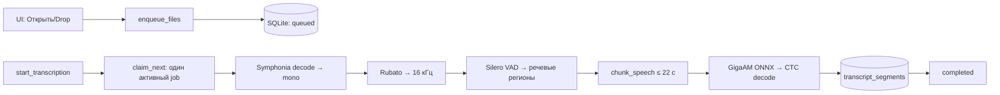
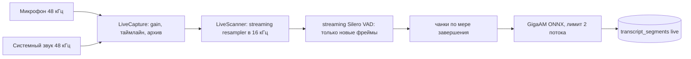
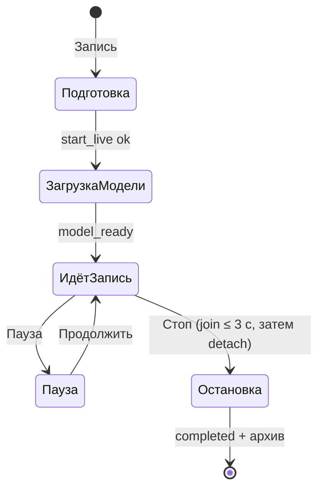

# Архитектура

Этот документ сохраняет подробные инженерные пояснения из прежнего корневого README. Интерфейс — статический SvelteKit внутри Tauri 2; декодирование, захват, инференс, хранение и экспорт выполняет Rust. Python-сервиса и серверной части нет.

## Транскрибация файла: от очереди до сегментов

У SQLite-очереди один активный worker. Сегменты сохраняются инкрементально. Состояние переживает перезапуск, а незавершённая обработка восстанавливается как `interrupted` и доступна для повтора.

## Живая запись

Windows использует WASAPI, включая render loopback; macOS — ScreenCaptureKit. Инференс идёт тиками по одной секунде. Пересканируется только неподтверждённый хвост («тихий курсор»): уже отданное аудио и VAD-подтверждённая тишина повторно не обрабатываются. Отработанное удаляется из памяти через `discard_before`, поэтому окно остаётся ограниченным.

Dual-сессии хранят потрековые архивы и `tracks.json` со стартовыми оффсетами. Для проигрывания `mixed_session_audio` создаёт микс по запросу. При повторном распознавании каждый архивный трек обрабатывается отдельно, а сегменты сливаются по времени с сохранением меток **Я / Система** (или **Me / System** в английском UI).

Live-треки сохраняются в выбранном пользователем FLAC, WAV или MP3. В режиме «система + микрофон» приложение запрашивает системную обработку звука, где она доступна, и дополнительно применяет консервативную временную проверку транскрипта против дублей звука динамиков.

Диагностика пишется в `gigaam-debug.log` в каталоге данных приложения: фазы старта/стопа, время загрузки модели, медленные тики и счётчики `mic_fed/sys_fed`, вставки тишины (`gap_ms`), битые пакеты (`err`) и ресинхронизации часов.

## Модель и чанкинг

Зафиксированные артефакты и полные хэши находятся в `src-tauri/src/model_manager.rs` (`ARTIFACTS`) и описаны в [MODEL.md](MODEL.md).

Параметры из `src-tauri/src/pipeline.rs`:

- порог речи: 0.5
- порог тишины: 0.35
- минимум речи: 200 мс
- минимум тишины: 100 мс
- паддинг региона: 120 мс
- предпочтительная граница после примерно 15 секунд
- предпочтительный максимум региона: примерно 22 секунды
- жёсткий лимит чанка: 30 секунд
- VAD-фрейм: 512 сэмплов; контекст: 64; частота: 16 кГц

## Хранилище

SQLite-файл расположен в каталоге данных приложения под именем `gigaam.sqlite3`:

- Windows: `%APPDATA%\ru.gigaam.desktop\gigaam.sqlite3`
- macOS: `~/Library/Application Support/ru.gigaam.desktop/gigaam.sqlite3`

`transcriptions` хранит метаданные, статус, прогресс чанков и пути к аудио. `transcript_segments` хранит индекс, тайминги, текст, трек и спикера. Нормальный путь статусов: `queued → preparing → transcribing → completed`; также есть `cancelled`, `failed` и `interrupted`. Сегменты каскадно удаляются вместе с записью истории.

## Команды Tauri

- Файлы/история: `enqueue_files`, `start_transcription`, `list_queue`, `list_history`, `search_history`, `get_segments`, `cancel_transcription`, `retry_transcription`, `remove_queue_item`, `delete_history`, `export_transcription`, `save_export`
- Запись: `start_live`, `stop_live`, `pause_live`, `resume_live`, `live_status`, `list_microphones`, `set_mic_gain`, `session_audio_files`, `mixed_session_audio`, `update_segment_text`, `rename_transcription`
- Модели: `model_status`, `download_model`, `cancel_model_download`

## Стек и компактность

- UI: Svelte 5 runes, SvelteKit, Vite и `adapter-static`; без веб-сервера и Electron.
- Десктоп: Tauri 2, системный WebView, single instance, asset protocol и плагины dialog/fs/opener.
- Ядро: стандартные Rust-потоки и `mpsc`; без async-runtime на горячих путях.
- Аудио: вендорный WASAPI на Windows, ScreenCaptureKit на macOS, Symphonia, Rubato, `hound`, `flac-codec` и MP3-кодировщик `shine-rs`.
- Инференс: ONNX Runtime через `ort`, без Python.
- Хранилище: встроенный SQLite через `rusqlite`.
- I18n: переключатель RU/EN без внешнего фреймворка.

В релиз не входят Chromium, Node.js или Python. Единственная runtime-загрузка — модели, которые хранятся отдельно от приложения. Транскрипты находятся в одном SQLite-файле, live-аудио — в потрековых архивах, микс создаётся по запросу.

## Структура кода

- `src/routes/+page.svelte` — UI и вызовы Tauri
- `src-tauri/src/domain.rs` — доменные типы и переходы состояний
- `src-tauri/src/storage.rs` — схема SQLite и запросы
- `src-tauri/src/queue.rs` — персистентная очередь с одним worker
- `src-tauri/src/pipeline.rs` — decode, resample, VAD, chunking, ONNX/CTC и `LiveScanner`
- `src-tauri/src/live.rs` — платформенный захват, синхронизация, gain, pause и архивы
- `src-tauri/src/export.rs` — TXT, SRT, WebVTT и JSON
- `src-tauri/src/model_manager.rs` — зафиксированная загрузка, SHA-256 и атомарная смена поколения моделей
- `src-tauri/src/lib.rs` — Tauri-команды и сборка приложения

## Осознанные ограничения

- один активный job делает потребление памяти и конкуренцию за CPU предсказуемыми
- live-инференс ограничивает число потоков модели
- поколение моделей принимается только после проверки всех артефактов и ready marker
- целевые системы — Windows x64 и Apple Silicon macOS; fallback-модуль захвата на других ОС возвращает ошибку неподдерживаемой платформы
